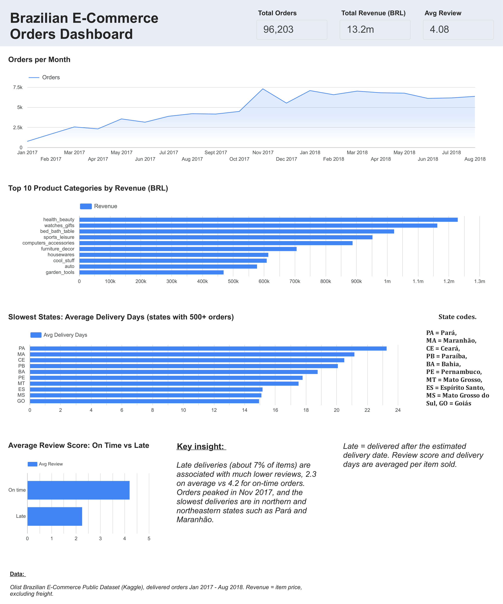

# Olist E-Commerce Orders Dashboard

Interactive dashboard and data preparation for the Olist Brazilian e-commerce dataset. Six relational tables are joined in Python (pandas), and the result is visualized in Looker Studio (Data Studio) to answer: *how do orders grow, what sells, where is delivery slow, and how does late delivery relate to customer reviews?*

📊 **Live dashboard:** https://datastudio.google.com/reporting/1247648d-406a-4f99-9a1c-afa5a95e52b7



## Key findings

- **Orders grew steadily** from 750 in Jan 2017 to a peak of 7,288 in Nov 2017, then stayed around 6,000–7,000 per month through Aug 2018.
- **Top revenue categories:** `health_beauty`, `watches_gifts`, and `bed_bath_table`.
- **Delivery is slowest in the north and northeast:** among states with 500+ orders, Pará (PA), Maranhão (MA), and Ceará (CE) have the longest average delivery times (about 23, 21, and 20 days).
- **Late delivery is associated with much lower reviews:** items delivered after the estimated date average a 2.26 review score, versus 4.21 for on-time items. About 6.6% of delivered items arrived late.

These are associations in observational data. The analysis does not show that lateness causes low reviews.

## Data

- **Source:** [Brazilian E-Commerce Public Dataset by Olist](https://www.kaggle.com/datasets/olistbr/brazilian-ecommerce) on Kaggle (about 100K orders, 2016–2018).
- **Licensing:** the dataset is published on Kaggle by Olist under its own license (check the Kaggle page for terms). The data is **not redistributed** in this repository. Download it from Kaggle to reproduce the analysis.

## What the notebook does

1. Loads the 9 CSV files and checks their sizes.
2. Uses 6 tables: `order_items`, `orders`, `customers`, `products`, `product_category_name_translation`, and `order_reviews`.
3. Builds one row per item sold (112,650 rows) by joining on keys, and verifies that the join creates **no duplicated rows** (112,650 before and after, 0 duplicates).
4. Collapses reviews to one score per order first, because some orders have several reviews and joining them directly would multiply rows.
5. Creates analysis columns: order month, delivery days, delay days (delivered vs estimated date), and a late / on-time flag.
6. Keeps only delivered orders (110,189 rows), then limits the period to **Jan 2017 – Aug 2018**, where the data is complete (109,872 rows, 96,203 unique orders).
7. Exports `olist_clean.csv` for the dashboard.

## Dashboard contents

| Element | Definition |
|---|---|
| Total Orders | distinct `order_id` |
| Total Revenue (BRL) | sum of item `price`, excluding freight |
| Avg Review | average `review_score` per item sold |
| Orders per Month | distinct orders by purchase month |
| Top 10 Categories | revenue by English category name |
| Slowest States | average delivery days, states with 500+ orders |
| On Time vs Late | average review score by delivery status (late = delivered after the estimated delivery date) |

## Limitations

- **One row is one item**, not one order. Orders with several items are counted several times in item-based measures (average review, share of late deliveries, average delivery days).
- **Review scores are averaged per order** and repeated on each item row, so the dashboard's average review is weighted by items sold.
- **Missing values:** 1,557 item rows have no product category and 823 have no review score. They are excluded from the related charts.
- **Only delivered orders** are analyzed. Canceled and in-transit orders are left out.
- **Revenue is item price only**, without freight, and is in Brazilian reais (BRL).
- **Period:** 2016 and the last weeks of 2018 contain very few orders, so they were excluded from time trends.

## Repository structure

```
├── notebooks/   olist_ecommerce_analysis.ipynb
├── images/      dashboard.png
└── README.md
```

## How to run

1. Download the dataset from Kaggle and unzip the 9 CSV files.
2. Open `notebooks/olist_ecommerce_analysis.ipynb` in Google Colab and upload the CSV files to the session.
3. Run the cells in order. The last cell creates `olist_clean.csv`.
4. In Looker Studio, upload `olist_clean.csv` as a data source and recreate the charts. Add calculated fields `order_date_d` and `order_month_d` with `PARSE_DATE("%Y-%m-%d", ...)`, and metrics `Orders = COUNT_DISTINCT(order_id)` and `Revenue = SUM(price)`.

## Tools

Python · pandas · Google Colab · Looker Studio

## Author

**Nalendra Whisnu Pinilih**
Information Systems graduate, Universitas Dian Nuswantoro · BNSP-certified Associate Data Scientist
[GitHub](https://github.com/nalendra-wp) · nalendrawp@gmail.com
